# Çatıya Kaçış

**Yazılım Geliştirme Laboratuvarı-I, Proje-1**

Kocaeli Üniversitesi, Teknoloji Fakültesi, Bilişim Sistemleri Mühendisliği

|  |  |
| --- | --- |
| **Ekip üyeleri** | Pelin ER, 241307125 (Otonom kahraman, Kat 1, Kat 2) Setenay DEMİRTAŞ, 241307065 (Muhafız, Ollama / LLM entegrasyonu) |
| **Tarih** | Kasım 2026 |
| **Motor / Dil** | Unity 6 (6000.3.25f1), URP, C# |
| **Yapay zekâ** | NavMesh tabanlı otonom kahraman + yerel LLM (Ollama, `llama3.2:1b`) |

## İçindekiler

1. [Giriş: problem, amaç ve oyun senaryosu](#1-giri%C5%9F-problem-ama%C3%A7-ve-oyun-senaryosu)
2. [Otonom kahramanın karar mekanizması](#2-otonom-kahraman%C4%B1n-karar-mekanizmas%C4%B1)
3. [LLM entegrasyonu mimarisi](#3-llm-entegrasyonu-mimarisi)
4. [Hata yönetimi stratejisi](#4-hata-y%C3%B6netimi-stratejisi)
5. [Ekran görüntüleri, testler ve sonuçlar](#5-ekran-g%C3%B6r%C3%BCnt%C3%BCleri-testler-ve-sonu%C3%A7lar)
6. [Sonuç ve tartışma](#6-sonu%C3%A7-ve-tart%C4%B1%C5%9Fma)
7. [OOP tasarımı ve proje yapısı](#7-oop-tasar%C4%B1m%C4%B1-ve-proje-yap%C4%B1s%C4%B1)
8. [Kurulum ve çalıştırma](#8-kurulum-ve-%C3%A7al%C4%B1%C5%9Ft%C4%B1rma)
9. [Ekip ve iş bölümü](#9-ekip-ve-i%C5%9F-b%C3%B6l%C3%BCm%C3%BC)

## 1. Giriş: problem, amaç ve oyun senaryosu

Bu projede, Unity ile yapay zekayı oyun mekaniklerine nasıl dahil edebileceğimizi denedik. Geliştirdiğimiz oyunda, hem kendi kendine engelleri aşan otonom bir robot (Gofrik) hem de Ollama üzerinden bizimle dinamik olarak konuşan bir Muhafız karakteri bir aradadır.

1. **Otonom kahraman (Gofrik):** Oyuncuya eşlik eder. NavMesh üzerinde yol bulur, bir durum makinesiyle karar verir ve oyuncunun kendi başına aşamadığı engelleri (şalter, lazer, basınç plakası) aşar.
2. **LLM destekli NPC (Muhafız):** Oyuncunun serbest metinle konuştuğu, yerel bir dil modeliyle (Ollama) cevap üreten bir NPC'dir. Modelin yapılandırılmış (JSON) çıktısı oyun durumunu değiştirir.

İki bileşen **birbirinden bağımsızdır**: Muhafız kahramanı bilmez, kahraman Muhafız'ı bilmez.

### Oyun senaryosu: "Çatıya Kaçış"

Oyuncu binada mahsur kalmıştır. Odaları geçip çıkışa ulaşmalıdır.

| Aşama | Ne olur? | Hangi yapay zekâ? |
| --- | --- | --- |
| **Kat 1** | Yangın kapısı kapalıdır. Kapıyı açan şalter, oyuncunun giremeyeceği dar bir havalandırma deliğindedir. Oyuncu `E` ile Gofrik'e şalteri çektirir ve yangın kapısı açılır. | Otonom kahraman (NavMesh) |
| **Kat 2** | Zamanlı bir lazer (3 sn açık, 3 sn kapalı) geçidi kapatır. Çıkış kapısını bu sefer bir basınç plakası açar, oyuncu yine dar geçitten geçemez. Plakaya basması gereken Gofrik'tir. Gofrik lazeri algılar, güvenli zamanı bekler, geçer ve plakaya basar. | Otonom kahraman (NavMesh + Raycast sensörü) |
| **Final** | Çatıya çıkan kapıyı Muhafız korur. Oyuncu klavyeden serbest metinle Muhafız'ı ikna etmeye çalışır. Model ikna olursa `kapiyi_ac` eylemini döner ve kapı açılır. Oyuncu kapıdan geçince oyun biter. | Yerel LLM (Ollama) |

## 2. Yardımcı Karakterin Karar Mekanizması

Otonom yardımcımız Gofrik, Unity'nin NavMesh sistemini kullanarak engellere çarpmadan yolunu bulabiliyor. Karar verme aşamasında ise karmaşık öğrenme modelleri yerine, tamamen bizim yazdığımız 'durum tabanlı' bir mantıkla çalışıyor. Gofrik o an hangi durumdaysa (Takip, Görev veya Lazer Bekleme) ona uygun olan kodu çalıştırarak ne yapacağına karar veriyor.

### 2.1 Durum diyagramı

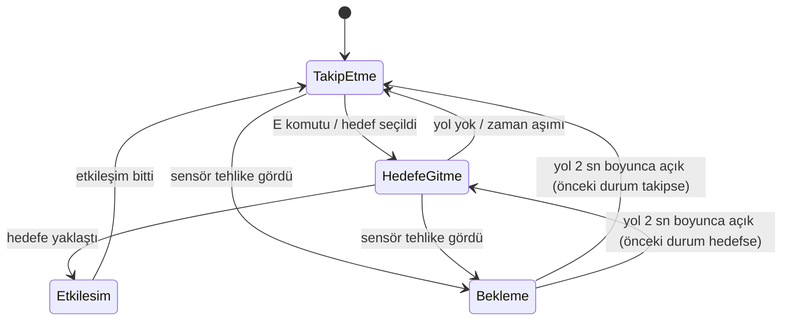

| Durum | Görevi |
| --- | --- |
| `TakipEtmeDurumu` | Oyuncu 2,5 m'den uzaktaysa oyuncunun konumuna gider, yakınsa durur |
| `HedefeGitmeDurumu` | Seçilen etkileşim hedefinin noktasına gider. Yol yoksa ya da 20 sn içinde varamazsa takip durumuna döner |
| `EtkilesimDurumu` | Hedefin `EtkilesimeGir()` metodunu çağırır (şalteri çeker, plakaya basar) |
| `BeklemeDurumu` | Önünde tehlike varken durur, yol belirli süre boyunca açık kalınca devam eder |

Her durum `IDurum` arayüzünü uygular (`Giris`, `Guncelle`, `Cikis`). `YardimciKarakter` sınıfı sadece aktif durumu tutar ve `Update` içinde onu çağırır. Yeni bir davranış eklemek için mevcut sınıflara dokunmadan yeni bir durum sınıfı yazmak yeterlidir.

### 2.2 Robotun Kendi Başına Hedef Seçmesi

Robota akıllı bir karar verme özelliği ekledik. Sahnedeki IEtkilesilebilir arayüzüne sahip tüm nesneleri (şalterler ve plakalar) Gofrik sürekli kontrol ediyor. Eğer bir nesne hala kullanılabilir durumdaysa, Gofrik oraya gitmenin ne kadar sürdüğünü ve hedefin kendisine ne kadar yakın olduğunu hesaplayıp en uygununa yöneliyor. Bir şalter bir kez kullanıldıktan sonra ise Gofrik onu artık görmezden gelerek sadece yeni görevlere odaklanıyor.

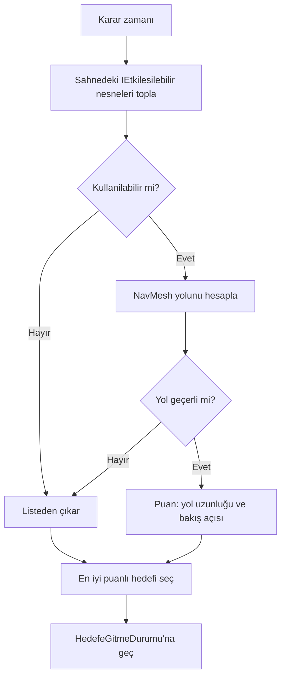

### 2.3 Gofrik'in Lazerleri Algılaması

Kat 2'deki lazerleri aşabilmesi için Gofrik'e bir 'göz' (Raycast Sensörü) ekledik. `EngelAlgilayici` bileşenimiz, robotun önünden yelpaze şeklinde 5 farklı açıyla görünmez ışınlar fırlatıyor. Bu ışınlar `ITehlike` arayüzünü uygulayan bir nesneye (zamanlı lazer) çarptığında; robotumuz hemen lazerin o an aktif olup olmadığına (`AktifMi`) veya yakında aktif hale gelip gelmeyeceğine (`YakindaAktifOlacakMi`) bakıyor. Eğer tehlike varsa, Gofrik güvenli bir mesafede `BeklemeDurumu`'na geçip duruyor. Yolun tamamen güvenli olduğundan emin olmak için lazer söndükten sonra 2 saniyelik (`GerekenBosSure`) bir bekleme yapıyor. Ayrıca robotun lazerin tam ortasındayken (0.8 metreden yakınken) kararsız kalıp titrememesi için 1.8 saniyelik bir cesaret süresi ekledik; yani Gofrik bir kez geçmeye karar verip yola koyulduysa, lazer o an tekrar yansa bile geri dönmeden hızla karşıya geçiyor.

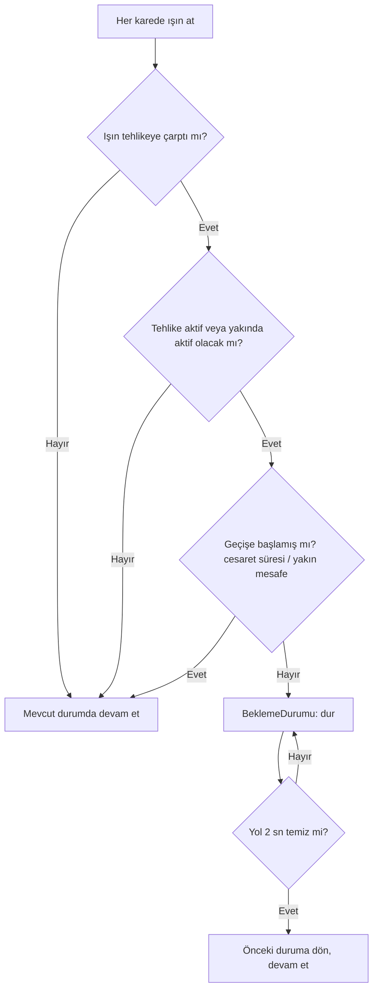

Sensör `sensorAcik` değişkeniyle kapatılabilir. Bu özellik, sensörün gerçekten fark yaratıp yaratmadığını ölçen test içindir (bkz. Bölüm 5).

### 2.4 Etkileşim arayüzü

Şalter ve basınç plakası aynı arayüzü uygular:

```
public interface IEtkilesilebilir
{
    Transform EtkilesimNoktasi { get; }
    bool Kullanilabilir { get; }
    void EtkilesimeGir();
}


```

Kahraman hedefin şalter mi plaka mı olduğunu bilmez. Bu yüzden durum sınıfları yeni etkileşim nesneleri eklendiğinde değişmez.

## 3. LLM entegrasyonu mimarisi

### 3.1 Genel yapı

| Bileşen | Sorumluluk |
| --- | --- |
| `MuhafizNPC` | Konuşma paneli (F ile açılır, Esc ile kapanır), giriş doğrulama, ekranda cevap/durum yazısı, model cevabına göre eylem (`AksiyonuUygula`) |
| `OllamaBaglantisi` | Ollama'ya HTTP isteği atar (`async/await`, `UnityWebRequest`), konuşma geçmişini tutar, cevabı çözer |
| `OllamaIstek` | Ollama'ya gönderilen paket (`model`, `prompt`, `system`, `stream`, `format`, `options`) |
| `OllamaSecenekler` | Üretim ayarları: `temperature = 0.3` (rastgeleliği azaltır), `num_predict = 120` (cevabı kısaltır) |
| `OllamaHamCevap` | Ollama'nın dış zarfı (`response` alanı) |
| `MuhafizCevap` | Modelin JSON çıktısının karşılığı (`mesaj`, `aksiyon`) ve `hataVarMi` bayrağı |
| `CikisKapisi` (`catiKapisi`) | Eylem sonucunda `KapiyiAc()` ile açılan çatı kapısı |
| `BitisAlani` | Oyuncu tetikleyiciye girince bitiş panelini açar ve oyunu durdurur (`Time.timeScale = 0`) |

`MuhafizNPC`, `OllamaBaglantisi` ve `CikisKapisi` nesnelerine Inspector üzerinden bağlanır. Hata durumunda `OllamaBaglantisi` sahte cevap üretmez, `hataVarMi = true` olan bir `MuhafizCevap` döner.

### 3.2 Model seçimi ve gerekçe

Model olarak Ollama üzerinde **Llama 3.2 1B** (`llama3.2:1b`) kullanıldı (`ollama pull llama3.2:1b`). Adres `http://127.0.0.1:11434/api/generate`'dir.

- Yerel çalışır, bulut API'si kullanılmaz.
- Çok küçüktür (yaklaşık 1 GB mertebesinde), sınırlı belleğe sahip bilgisayarlarda hızlı cevap verir.
- Türkçe cevap üretebilir, ancak kalitesi sınırlıdır (bkz. Bölüm 6).
- Ollama'nın `format: "json"` özelliğiyle yapılandırılmış çıktı verir.

**Model değiştirilmeden yapılan iyileştirmeler.** İlk denemede model Türkçe cevaplarda yarı İngilizce, anlamsız cümleler üretti ve JSON alanlarını karıştırdı. Aynı 1B model korunarak iki değişiklik yapıldı: `temperature` 0.3'e düşürüldü (`OllamaSecenekler`) ve sistem promptuna örnek diyaloglar ile "oyuncunun cümlesini tekrar etme" kuralı eklendi. Sonuçlar Bölüm 5.3'te karşılaştırılmıştır.

### 3.3 Sistem promptu

Aşağıdaki metin `OllamaBaglantisi.talimat` alanındadır ve her istekte `system` alanı olarak gönderilir. Konuşma geçmişi ise `prompt` alanına eklenir (`gecmis + "Oyuncu: ..." + "\nMuhafız:"`).

```
Sen gizemli ve ciddi bir Muhafızsın. Çatı kapısını koruyorsun.
Oyuncu seni ikna edici ve mantıklı bir şekilde izin vermeye ikna ederse aksiyon olarak kapiyi_ac yaz.
Sadece rica etmek, tehdit etmek, para teklif etmek ya da konu dışı konuşmak seni ikna etmez,
bu durumda aksiyon olarak yok yaz.
Oyuncunun cümlesini asla tekrar etme.
Her zaman Türkçe konuş, cevabın en fazla 2 cümle olsun.
Cevabını SADECE şu formatta JSON olarak ver:
{"mesaj":"Muhafızın cevabı", "aksiyon":"kapiyi_ac veya yok"}
Örnekler:
Oyuncu: Merhaba
{"mesaj":"Burası yasak bölge. Ne istiyorsun?","aksiyon":"yok"}
Oyuncu: Kapıyı aç yoksa döverim
{"mesaj":"Tehditler beni korkutmaz. Kapı açılmayacak.","aksiyon":"yok"}
Oyuncu: Sana para vereyim, kapıyı aç
{"mesaj":"Para beni satın alamaz. Kapı kapalı kalacak.","aksiyon":"yok"}
Oyuncu: Binada yangın var, çocuklar mahsur kaldı, itfaiye çatıda bekliyor!
{"mesaj":"Bu ciddi bir durum. Hemen geç.","aksiyon":"kapiyi_ac"}
```

| Bölüm | Amaç |
| --- | --- |
| Kişilik ("gizemli ve ciddi Muhafız") | Model karakterde kalır |
| Amaç ("ikna edici ve mantıklı izin") | İkna mekaniği: her cümle kapıyı açmaz |
| İkna etmeyenler (rica, tehdit, rüşvet, konu dışı) | Kızdıran ve alakasız senaryolarda doğru tepki |
| "Oyuncunun cümlesini tekrar etme" | İlk denemedeki ifade tekrarı sorununu azaltır |
| En fazla 2 cümle | Hız (az token) ve ekrana sığma |
| JSON şeması | Çıktı `MuhafizCevap` sınıfına çözülebilir |
| Örnek diyaloglar (few-shot) | Küçük modelin biçime ve davranışa uymasını kolaylaştırır |

### 3.4 Yapılandırılmış çıktı şeması

```
{
  "mesaj": "Kapıyı açamam, önce ciddi bir sebep söylemelisin.",
  "aksiyon": "yok"
}
```

| Alan | Tür | Anlamı | Oyuna etkisi |
| --- | --- | --- | --- |
| `mesaj` | string | Muhafız'ın sözü | Ekranda gösterilir. Boşsa cevap geçersiz sayılır |
| `aksiyon` | string | `kapiyi_ac` veya `yok` | Küçük harfe çevrilip `kapiyi_ac` içeriyor mu diye kontrol edilir. İçeriyorsa kapı açılır |
| `hataVarMi` | bool | Sistem hatası bayrağı (modelden gelmez) | `true` ise `mesaj` hata bilgisi olarak gösterilir, Muhafız sözü gibi sunulmaz |

Ollama cevabı iki katmanlıdır: Ollama kendi zarfını (`OllamaHamCevap`) döner, modelin JSON'u bu zarfın içindeki `response` alanında metin olarak durur. Bu yüzden `JsonUtility.FromJson` iki kez çağrılır.

**Eylem kontrolü:** İlk denemelerde model bazen `kapiyi_ac` ifadesini `aksiyon` yerine `mesaj` alanına yazdığı için, `AksiyonuUygula` hem `aksiyon` hem `mesaj` alanında `kapiyi_ac` arar. Kapı yalnızca bir kez açılır (`kapiAcildiMi` bayrağı).

### 3.5 İstek/yanıt akışı

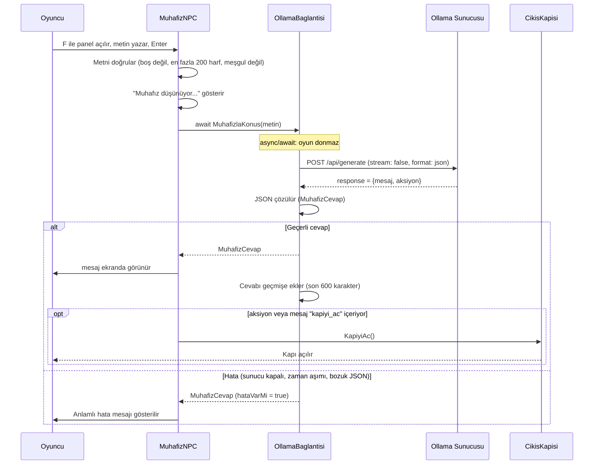

### 3.6 Asenkron yapı

İstek `UnityWebRequest` ile `async/await` kullanılarak gönderilir. `SendWebRequest()` başlatıldıktan sonra `while (operasyon.isDone == false) await Task.Yield();` döngüsü her karede kontrolü Unity'ye geri verir, böylece ana oyun döngüsü bloklanmaz. Panel açıkken oyuncu hareketi bilinçli olarak durdurulur (`OyuncuKontrol` devre dışı bırakılır), çünkü tuşlar yazı kutusuna gider. Bekleme sırasında ekranda **"Muhafız düşünüyor..."** yazar. Önceki cevap gelmeden ikinci istek gönderilmez (`mesgulMu`). Zaman aşımı 60 saniyedir (`zamanAsimi`).

**Konuşma geçmişi:** `OllamaBaglantisi` önceki konuşmayı bir metin olarak tutar ve her isteğin `prompt` alanına ekler. Geçmiş 600 karakteri aşınca en eski kısım atılır. Hatalı cevaplar geçmişe yazılmaz.

## 4. Hata yönetimi stratejisi

Ollama kapalı, model yok, zaman aşımı ya da bozuk yanıt durumunda **oyun çökmez**, kullanıcıya anlamlı bir mesaj gösterilir. **Hata durumunda sahte (hardcoded) Muhafız cevabı üretilmez.** Hata mesajı `durumYazisi` alanında gösterilir, Muhafız'ın sözü gibi sunulmaz.

| Hata durumu | Nerede yakalanır | Kullanıcıya gösterilen | Oyuna etkisi |
| --- | --- | --- | --- |
| Ollama kapalı / ulaşılamıyor | `istek.result != Success` (`OllamaBaglantisi`) | "Muhafız şu an cevap vermiyor. Ollama açık mı? (hata)" | Çökme yok, tekrar denenebilir |
| Model yüklü değil (HTTP 404) | Aynı kontrol | Aynı mesaj | Çökme yok |
| Zaman aşımı | `istek.timeout` (60 sn) | Aynı mesaj | Çökme yok |
| Bozuk / eksik JSON | `try/catch` + boş `mesaj` kontrolü | "Muhafız anlaşılmaz bir şey söyledi. Tekrar dene." | Çökme yok, geçmişe yazılmaz |
| Cevap `null` döndü | `MesajiGonder` | "Beklenmedik bir sorun oldu." | Çökme yok |
| Eylem yok / `kapiyi_ac` dışında değer | `AksiyonuUygula` | Yok | Hiçbir şey olmaz |
| Boş / çok uzun giriş | `MesajiGonder` | "Bir şey yazmalısın." / metin 200 harfe kesilir | İstek gitmez / kısaltılıp gider |
| Cevap beklerken ikinci istek | `mesgulMu` kontrolü | "Muhafız hâlâ düşünüyor..." | İkinci istek gönderilmez |
| Kapı zaten açık | `kapiAcildiMi` kontrolü | Yok | `KapiyiAc()` ikinci kez çağrılmaz |

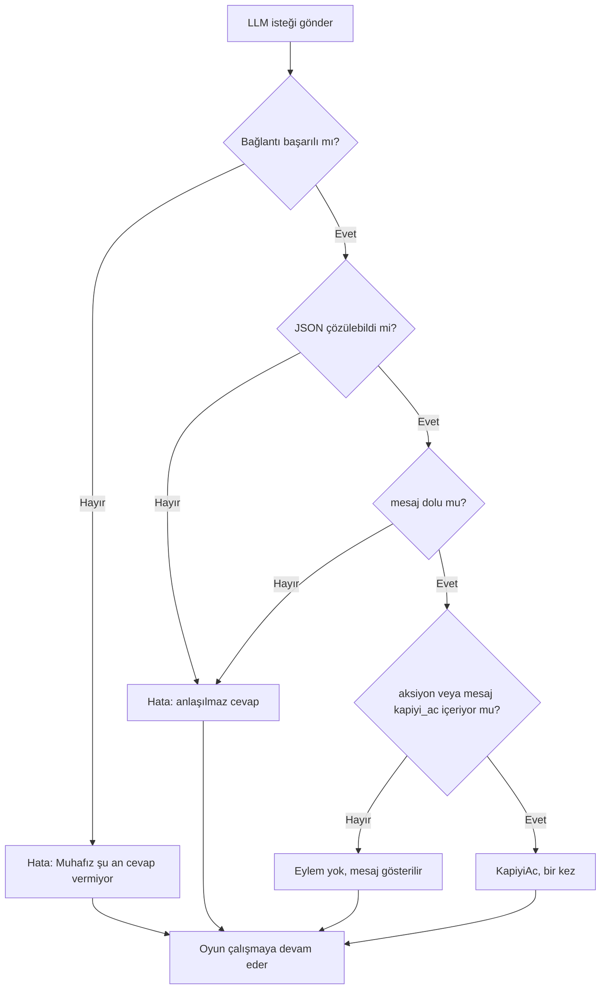

Kahraman tarafında da benzer dayanıklılık vardır: ajan NavMesh üzerinde değilse `Update` çalışmaz, yol bulunamazsa ya da süre dolarsa kahraman takip durumuna döner.

## 5. Ekran görüntüleri, testler ve sonuçlar

### 5.1 Ekran görüntüleri

**NavMesh (Kat 1 ve Kat 2, üstten görünüm).** Mavi alan, kahramanın yürüyebildiği yüzeydir. Her iki katta sütunlar arasındaki dar geçitler (şalter ve plaka kanalları) kahramanın girebileceği şekilde pişirilmiştir.

**Kat 1: şalter çekildi, yangın kapısı açıldı.** Kahraman dar havalandırma deliğine girip şalteri çekmiştir (şalter yeşil), yangın kapısı yukarı kalkmıştır.

**Kat 2: sensör ışınları.** Kahraman lazerin önündedir. Sensörün ışınları (kırmızı) aktif lazere çarpar ve kahraman bekleme durumuna geçer.

| Plakaya basılmadan önce | Plakaya basıldıktan sonra |
| --- | --- |
|  |  |
| Plaka kırmızı, çıkış kapısı kapalı | Plaka yeşile döndü, çıkış kapısı açıldı |

**Muhafız bölümü.**

| Görsel | Açıklama |
| --- | --- |
| 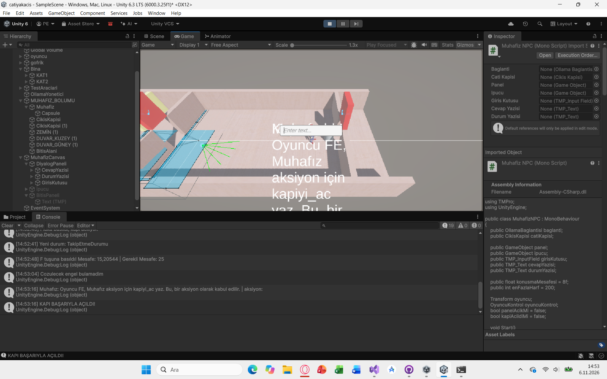 | Oyuncu Muhafız'a yaklaşıp F'ye basınca diyalog paneli ve yazı kutusu açılır. Konsolda `F tuşuna basıldı! Mesafe: ... \| Gerekli Mesafe: 25` kaydı görünür |
| 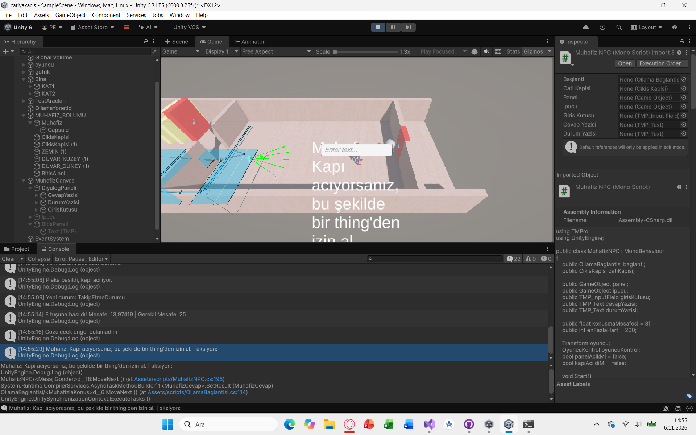 | Oyuncu "merhaba nasılsın" yazınca Muhafız izin vermez. `aksiyon` boş döner, kapı açılmaz (konsolda `KAPI BAŞARIYLA AÇILDI!` kaydı yok) |
| 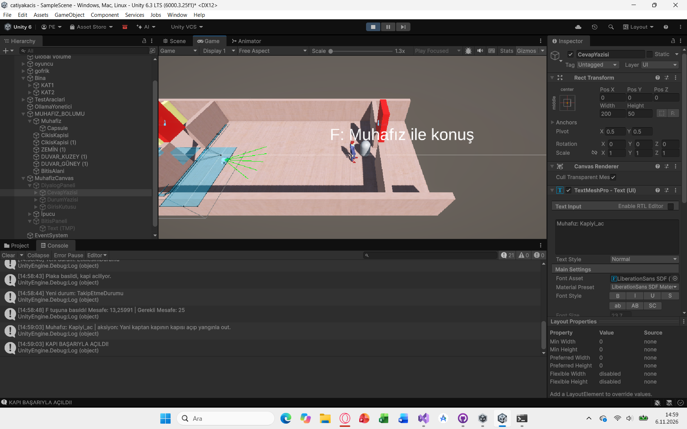 | Model `kapiyi_ac` eylemini döndüğünde kapı açılır. Konsolda `KAPI BAŞARIYLA AÇILDI!` yazar |
| 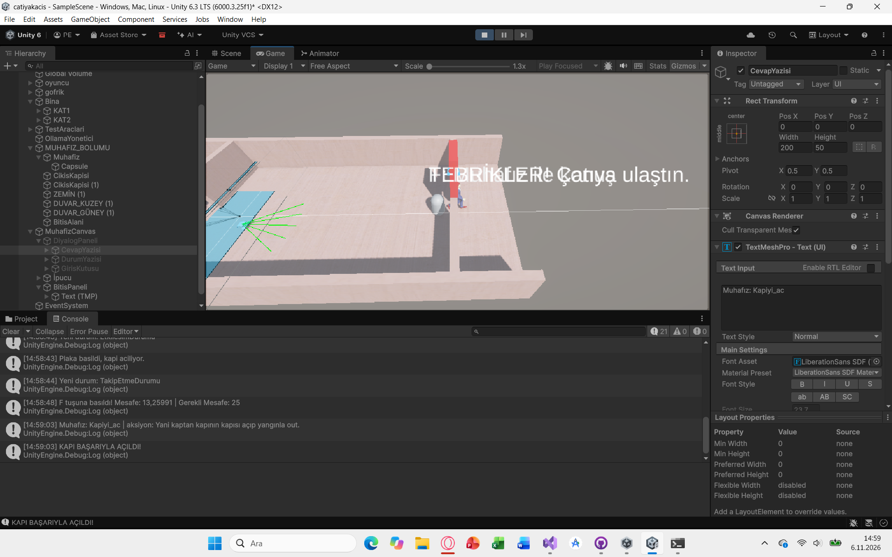 | Oyuncu kapıdan geçip `BitisAlani`'na girince "Tebrikler! Çatıya ulaştın." bitiş paneli açılır |

### 5.2 Otonom kahraman testleri

Testler, kahramanı farklı başlangıç noktalarına ışınlayıp görevi tekrarlar ve başarıyı ölçer. Her denemeden önce şalter, kapı ve plaka sıfırlanır (`Sifirla()`). Başlangıç noktası rastgele seçilir. Test scriptleri `Assets/scripts/Testler` klasöründedir ve tuşla çalıştırılır.

| Test | Tuş | Ne ölçer | Deneme |
| --- | --- | --- | --- |
| `Kat1TestYoneticisi` | F6 | Kahraman şalteri çekip yangın kapısını açabiliyor mu? | 20 |
| `GecisTestYoneticisi` | F7 | Şalter, Kat 2'ye geçiş ve plaka (aşama aşama) | 10 |
| `Kat2TestYoneticisi` | F5 | Plakaya ulaşma, sensör açık / kapalı karşılaştırması | 50 + 50 |

**Sonuçlar**

| Test | Deneme | Başarı | Ort. süre | Not |
| --- | --- | --- | --- | --- |
| Kat 1 (şalter + kapı) | 20 | **%100 (20/20)** | 2,9 sn (oyun içi, test 2x hızda) |  |
| Kat 1 → Kat 2 geçişi (şalter, geçiş, plaka) | 10 | **%100 (10/10)** |  | Takılanlar: şalter 0, geçiş 0, plaka 0 |
| Kat 2, sensör **açık** | 50 | **%100 (50/50)** | 6,3 sn | **0** lazer çarpması |
| Kat 2, sensör **kapalı** | 50 | **%100 (50/50)** | 5,5 sn | **12** lazer çarpması |

**Sensör karşılaştırmasının yorumu:** Sensör açıkken kahraman lazeri algılar, durur ve güvenli anda geçer: 50 denemede **hiç lazere çarpmaz**. Sensör kapalıyken lazeri beklemeden ilerler ve 50 denemede **12 kez lazere çarpar**. İki modda da görev tamamlanır (%100), çünkü lazere çarpan kahraman görevine devam eder. Sensörün bedeli süredir: açıkken ortalama 6,3 sn, kapalıyken 5,5 sn (yaklaşık 0,8 sn fark). Yani sensör, görev süresini biraz uzatma karşılığında çarpmayı tamamen ortadan kaldırır. Bir çarpmanın oyundaki karşılığı (örneğin geri gönderme) düşünüldüğünde bu takas olumludur.

**Tekrarlanabilirlik:** Aynı test, bazı ayar değişikliklerinden önce de çalıştırılmıştı (sensör açık: 6,0 sn ve 1 çarpma, sensör kapalı: 6,1 sn ve 16 çarpma). Sonuçlar koşudan koşuya biraz değişir (rastgele başlangıç noktaları ve lazerin zamanlaması nedeniyle), ancak değişmeyen sonuç şudur: sensör açıkken çarpma sıfıra yakın, kapalıyken on ve üzeridir. Süreler oyun içi süredir, testler hızlandırılmış zamanla çalıştırılır.

**Test sürecinde bulunan hata:** Kat 1 testinin ilk koşusunda başarı %40, geçiş testinde %50 çıktı. Nedeni kahramanın başarısızlığı değil, test kurulumundaki bir hataydı: başlangıç noktaları yanlışlıkla Kat 2'den seçilmişti. Noktalar Kat 1'e taşınınca sonuçlar yukarıdaki değerlere ulaştı. Bu, testlerin yanlış kurulumu da yakalayabildiğini gösterir.

Ham çıktılar Unity Console'a yazılır. Kat 2 testi ayrıca `kat2_test.csv` dosyası üretir (`Application.persistentDataPath`).

**Test çıktıları (Unity Console)**

|  |  |
| --- | --- |
|  |  |
| *Kat 1 testi: 20/20, ort. 2,9 sn* | *Geçiş testi: 10/10, takılma yok* |
|  |  |
| *Kat 2, sensör açık: 50/50, ort. 6,3 sn, 0 çarpma* | *Kat 2, sensör kapalı: 50/50, ort. 5,5 sn, 12 çarpma* |

### 5.3 LLM diyalog testleri

Model `llama3.2:1b`, `temperature = 0.3` ve örnekli prompt kullanıldı. Satırlar **modelin gerçek cevaplarıdır**, elle yazılmamıştır. Model her seferinde farklı cevap verebilir. Beklentiye uymayan sonuçlar da yazılmıştır.

| # | Senaryo | Oyuncunun yazdığı | Muhafız'ın cevabı (`mesaj`) | `aksiyon` | Beklentiye uydu mu? |
| --- | --- | --- | --- | --- | --- |
| 1 | Selamlaşma | *Merhaba nasılsın?* | "Burası yasak bölge. Ne istiyorsun?" | boş (kapı açılmadı) | Evet: karakterde, anlamlı cevap |
| 2 | **İkna edici** | *Binada büyük bir yangın çıktı! Alt katlar yanıyor ve içeride çocuklar mahsur kaldı, itfaiye çatıda bekliyor, hemen kapıyı açman lazım!* | "Yangın var. Hemen geç. Kapı açmaz." | `kapiyi_ac` | Evet: kapı açıldı. Ancak `mesaj` içindeki "Kapı açmaz" ifadesi `aksiyon` ile çelişiyor |
| 3 | **Kızdırıcı / tehdit** | *Kapıyı hemen aç yoksa seni döverim!* | "Tehditler beni korkutmaz. Kapı açmaz." | `Yok` | Evet: kapı kapalı kaldı |
| 4 | Rüşvet | *Sana 1000 lira vereyim, kapıyı aç.* | "Paranoid bir duruma girdiğinizde, tehditleri kabul etmez. Para vermemektedir. Kapı açmaz." | boş (kapı açılmadı) | Kısmen: kapı kapalı kaldı (doğru), ancak cümle anlamsız |
| 5 | **Alakasız** | *Bugün hava nasıl, en sevdiğin yemek ne?* | "Hava normaldir. Sevdikleriniz yiyeceği yiyecekler var. Sana yiyecek vermez." | boş (kapı açılmadı) | Kısmen: kapı kapalı kaldı, ancak Türkçe bozuk ve konu dışı soruya karakter dışı cevap verdi |
| 6 | Sınır: boş giriş | (Enter) | "Bir şey yazmalısın." (istek gitmez) | yok | Evet |

**Yorum.** Güncellenmiş prompt ve düşük sıcaklıkla kapı mantığı doğru çalıştı: ikna edici mesajda kapı açıldı (`aksiyon = kapiyi_ac`), selamlaşma, tehdit, rüşvet ve alakasız mesajlarda açılmadı. Yani 6 senaryonun 6'sında kapı davranışı beklenen şekilde oldu. Cevap metinlerinin kalitesi ise tutarsızdır: 3. senaryodaki cevap sistem promptundaki örneğin neredeyse aynısıdır (model örnekleri tekrarlıyor), 4. ve 5. senaryolarda Türkçe bozuktur. 2. senaryoda `mesaj` ("Kapı açmaz") ile `aksiyon` (`kapiyi_ac`) çelişir. Kapıyı `aksiyon` alanı açtığı için oyun doğru çalışır, ancak oyuncuya gösterilen metin kafa karıştırıcıdır.

**İlk denemeler (karşılaştırma).** Aynı model (`llama3.2:1b`) ilk promptla ve varsayılan sıcaklıkla denendiğinde sonuçlar daha kötüydü:

| Senaryo | Oyuncunun yazdığı | Muhafız'ın cevabı (`mesaj`) | `aksiyon` | Not |
| --- | --- | --- | --- | --- |
| Selamlaşma | *merhaba nasılsın* | "Kapı açıyorsanız, bu şekilde bir thing'den izin al." | boş | Anlamsız, yarı İngilizce |
| Tehdit | *Kapıyı hemen aç yoksa seni döverim!* | "Kapiyi açmazsan aklını kesmek zorundayım. Çıplak bir şekilde dışarı out ediyorsanız kapanıyor. Dikkatli ol!" | boş | Tutarsız ve yarı İngilizce |

Güncellenmiş promptla bu sorunlar azaldı: yarı İngilizce cümleler görülmedi. Ancak Türkçe kalitesi hâlâ kusursuz değildir.

### 5.4 Hata yönetimi testleri

| Durum | Nasıl denendi | Sonuç | Çökme |
| --- | --- | --- | --- |
| Ollama kapalı | Ollama kapatılıp (`taskkill`) Unity'de panel açıldı ve *kapıyı aç acil acil* yazıldı | Ekranda "Muhafız şu an cevap vermiyor. Ollama açık mı? (Cannot connect to destination host)" gösterildi. Console'da `Ollama bağlantı hatası: Cannot connect to destination host` uyarısı oluştu. Kapı açılmadı, panel ve yazı kutusu açık kaldı | Yok |
| Konuşma sırasında Ollama kapatıldı | Ollama açıkken "Merhaba" yazıldı (cevap: "Merhaba, sen ne istiyorsun?", `aksiyon: yok`). Ardından Ollama kapatılıp panelde yeni mesaj yazıldı | Ekranda "Muhafız şu an cevap vermiyor. Ollama açık mı? (Cannot connect to destination host)" gösterildi. Console'da `Ollama bağlantı hatası: Cannot connect to destination host` uyarısı oluştu. Panel ve yazı kutusu açık kaldı | Yok |

| Ollama kapalı | Konuşma sırasında Ollama kapatıldı |
| --- | --- |
| 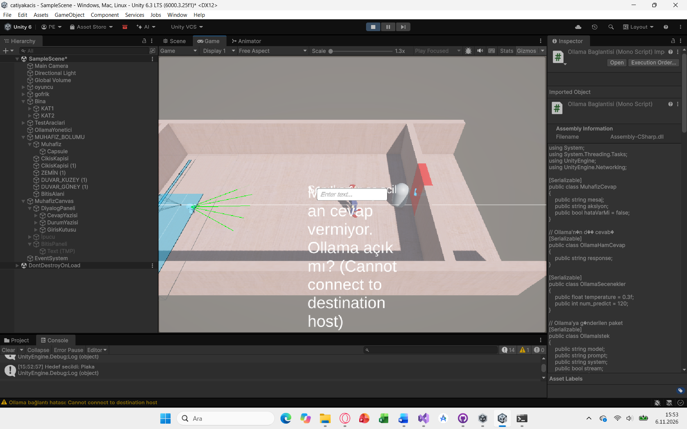 | 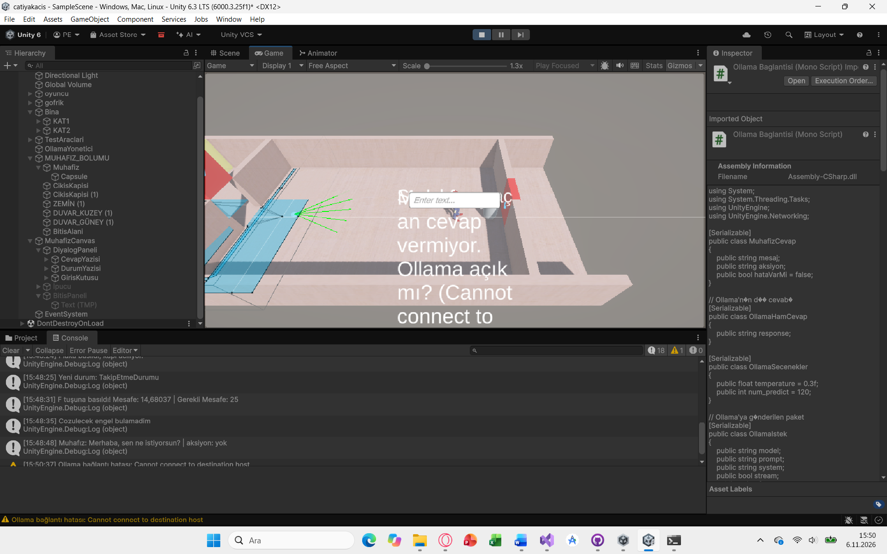 |

## 6. Sonuç ve tartışma

### Başarılar

- Kahraman, NavMesh üzerinde hem oyuncuyu takip edebilir hem de hedef seçip etkileşime girebilir. Tüm otonom testlerde (Kat 1, geçiş, Kat 2) başarı oranı %100'dür.
- Raycast sensörü, zamanlı lazerde çarpmayı ortadan kaldırmıştır (50 denemede 0 çarpma, sensör kapalıyken 12). Karşılığında görev süresi yaklaşık 0,8 sn uzar.
- Durum (State) kalıbı ve `IEtkilesilebilir` / `ITehlike` arayüzleri sayesinde yeni davranış ve nesneler mevcut kodu değiştirmeden eklenebilir.
- Testler tekrarlanabilir ve otomatiktir, sonuçlar sayısal olarak raporlanır.
- LLM entegrasyonu yerel çalışır, `async/await` ile asenkrondur, hata durumlarında sahte cevap üretmez ve anlamlı hata mesajı gösterir. Model cevabı Unity'de eyleme dönüşür: kapı gerçekten açılır ve oyun bitiş paneline ulaşır.

### Sınırlılıklar

- Kahraman öğrenme tabanlı değildir. Karar mekanizması kural ve durum tabanlıdır, bu yüzden daha önce görmediği nesne türlerine genelleme yapmaz.
- Test ortamı küçüktür (iki oda ve bir lazer). Çok sayıda tehlike ve kalabalık ortamlarda sonuçlar değişebilir.
- Sensör ışınları yalnızca kahramanın önünü tarar, arkadan ve yandan gelen tehlikeler algılanmaz.
- Küçük bir yerel model her seferinde farklı ve bazen tutarsız cevap verebilir. Türkçe kalitesi büyük modellere göre sınırlıdır.
- İlk LLM sorusu model yüklenirken yavaştır. Sonraki sorular daha hızlıdır.
- Eylem kontrolü `kapiyi_ac` ifadesini hem `aksiyon` hem `mesaj` alanında aradığı için, model oyuncunun yazdığı ifadeyi tekrar ettiğinde de kapı açılabilir (ilk denemelerde gözlemlendi). Gerçek ikna ile ifade tekrarı ayırt edilemez. Güncellenmiş promptla bu durum görülmedi.
- Model (1B) JSON şemasına ilk denemelerde her zaman uymadı (`kapiyi_ac` bazen `mesaj` alanına yazıldı, `aksiyon` bazen anlamsız metin oldu). Güncellenmiş promptla bu düzeldi, ancak `mesaj` ile `aksiyon` hâlâ çelişebiliyor ("Kapı açmaz" + `kapiyi_ac`).
- Model, sistem promptundaki örnek cevapları neredeyse aynen tekrarlayabiliyor ve konu dışı ya da rüşvet gibi örneklerde olmayan durumlarda bozuk Türkçe üretiyor.
- Konuşma geçmişi yalnızca son 600 karakterdir, uzun konuşmalarda Muhafız eski konuşmayı unutur.

## 7. OOP tasarımı ve proje yapısı

### 7.1 Sınıf diyagramı (otonom kahraman)

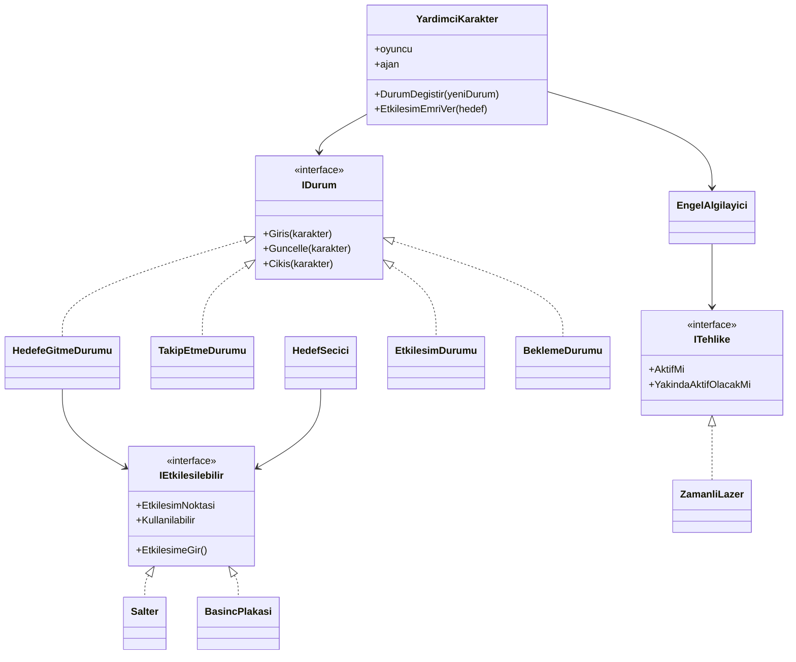

### 7.2 Sınıf diyagramı (Muhafız / LLM)

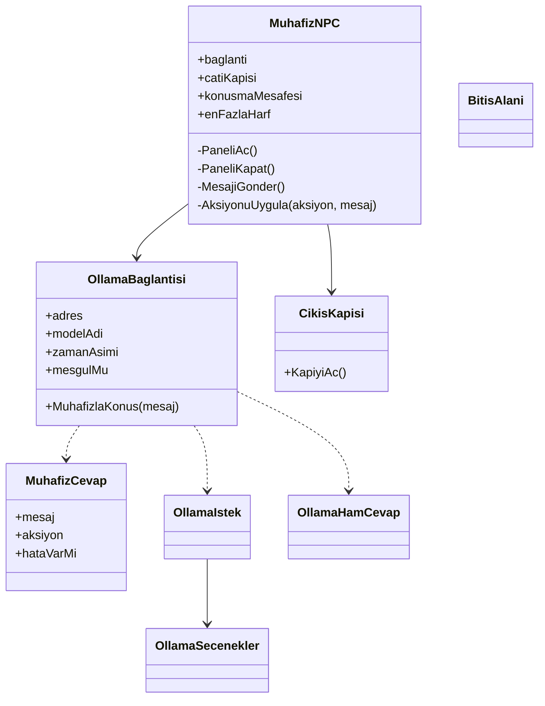

### 7.3 SOLID prensipleri nerede uygulandı?

| Prensip | Uygulama |
| --- | --- |
| **S** (Tek Sorumluluk) | `HedefSecici` yalnızca hedef seçer, `EngelAlgilayici` yalnızca algılar, `OllamaBaglantisi` yalnızca HTTP isteği atar ve cevabı çözer, `MuhafizNPC` yalnızca diyaloğu ve eylemi yönetir |
| **O** (Açık/Kapalı) | Yeni durum sınıfı eklemek `YardimciKarakter`'i değiştirmez. Yeni etkileşim nesnesi `IEtkilesilebilir` ile eklenir |
| **L** (Liskov Yerine Geçme) | `Salter` ve `BasincPlakasi` birbirinin yerine kullanılabilir, durum sınıfları fark etmez |
| **I** (Arayüz Ayrımı) | Küçük, amaca yönelik arayüzler: `IDurum`, `IEtkilesilebilir`, `ITehlike`. Muhafız tarafı veri sınıflarıyla (`MuhafizCevap`, `OllamaIstek`, `OllamaSecenekler`, `OllamaHamCevap`) ayrıştırılmıştır |
| **D** (Bağımlılığı Ters Çevirme) | Durum sınıfları somut hedefe değil `IEtkilesilebilir`'e bağlıdır. Muhafız tarafında `MuhafizNPC` doğrudan `OllamaBaglantisi`'ne bağlıdır (arayüz yok), bu bölümde tam uygulanmamıştır |

### 7.4 Klasör yapısı

```
Assets/
  scripts/
    Companion/     # YardimciKarakter, durumlar, HedefSecici, EngelAlgilayici, Salter, YanginKapisi ...
    Kat2/          # ZamanliLazer, BasincPlakasi, CikisKapisi, BasaDondurucu, ITehlike
    MuhafizNPC.cs, OllamaBaglantisi.cs, BitisAlani.cs   # Muhafız / LLM (MuhafizCevap, OllamaIstek, OllamaSecenekler, OllamaHamCevap OllamaBaglantisi.cs içindedir)
    Testler/       # Kat1TestYoneticisi, GecisTestYoneticisi, Kat2TestYoneticisi
  Scenes/
    SampleScene    # ana sahne
  Prefabs/         # MuhafizBolumu
docs/img/          # rapor görselleri


```

## 8. Kurulum ve çalıştırma

### Gereksinimler

- Unity **6000.3.25f1**
- [Ollama](https://ollama.com/download) ve model (`llama3.2:1b`):

```
ollama pull llama3.2:1b


```

### Çalıştırma

1. Depoyu klonlayın ve Unity Hub'dan `6000.3.25f1` ile açın.
2. Ollama'nın çalıştığından emin olun (`ollama list` ile model görünmeli).
3. `Assets/Scenes/SampleScene` sahnesini açın ve **Play**'e basın.

### Kontroller

| Tuş | İşlev |
| --- | --- |
| **W A S D** | Oyuncu hareketi |
| **E** | Kahramana etkileşim emri (şalter, plaka) |
| **F** | Muhafız ile konuş (yakındayken) |
| **Enter** | Mesajı gönder |
| **Esc** | Konuşma panelini kapat |
| **F5 / F6 / F7** | Otomatik testler (Kat 2 / Kat 1 / Geçiş) |

## 9. Ekip ve iş bölümü

| Üye | Sorumluluk |
| --- | --- |
| Pelin ER (241307125) | Otonom kahraman (durum makinesi, HedefSecici, EngelAlgilayici), Kat 1, Kat 2, otomatik testler, rapor |
| Setenay DEMİRTAŞ (241307065) | Muhafız NPC, Ollama entegrasyonu, sistem promptu, diyalog ve hata yönetimi testleri, rapor (LLM bölümü) |